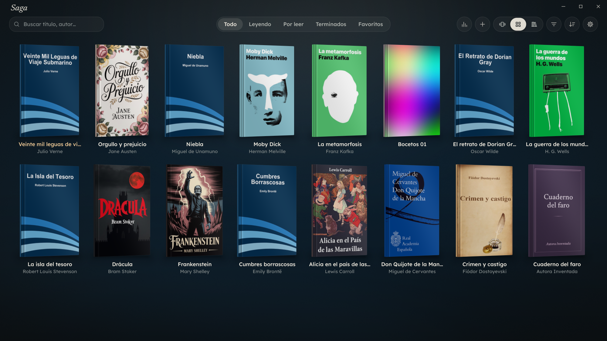
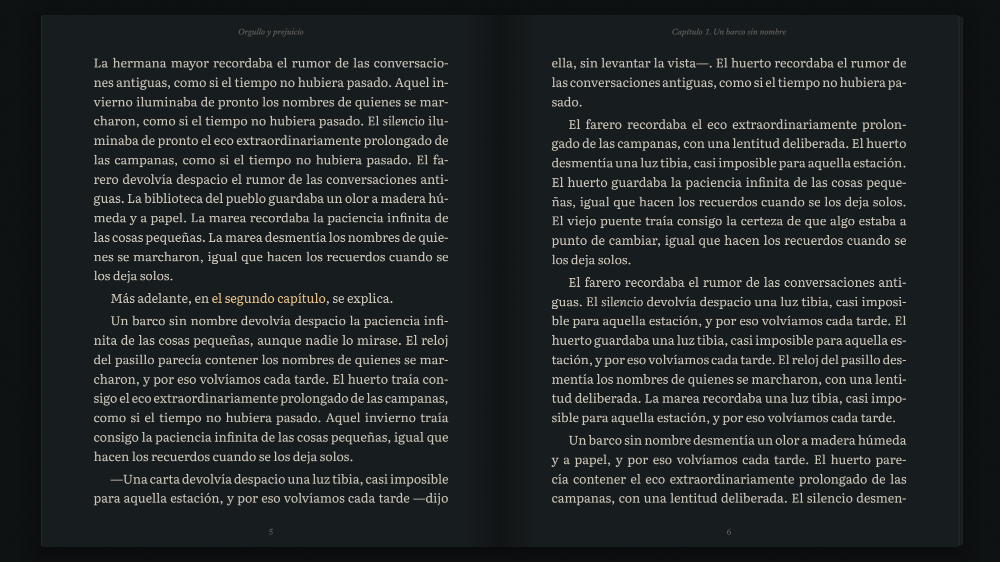

# Saga

**Biblioteca y lector de libros para Windows.** Rápida, ligera y tranquila: tus libros como portadas 3D finas, su ficha con metadatos de internet y un lector completo con temas, índice, subrayados, notas tipo pósit y paso de página animado.




## Instalar

1. Descarga **`Saga-1.0.2-Instalador.rar`** (o directamente `Saga-Instalador.exe`) desde [Releases](https://github.com/josecv222/Saga/releases/latest).
2. Descomprime y abre `Saga-Instalador.exe` → **Instalar**.

Se instala solo para tu usuario, sin permisos de administrador, en `%LOCALAPPDATA%\Programs\Saga`, y crea:

- acceso en el menú Inicio (y en el escritorio si lo dejas marcado);
- **«Abrir con > Saga»** para tus libros, sin cambiar tu programa predeterminado;
- su entrada en *Configuración > Aplicaciones* para desinstalar.

Como el instalador no está firmado, Windows puede mostrar *«Windows protegió tu PC»*: pulsa **Más información → Ejecutar de todas formas**.

Para actualizar, abre el instalador nuevo: tu biblioteca, notas y progreso se conservan.

## Qué hace

**Biblioteca**
- Portadas 3D en carrusel, cuadrícula o estantería, con filtros (leyendo, por leer, terminados, favoritos), búsqueda y orden.
- Añade libros con el botón **+**, arrastrándolos a la ventana o con «Abrir con».
- **Metadatos automáticos**: título, autor, año, géneros, ISBN, descripción y portada desde Open Library, Google Books e iTunes. No hace falta cuenta ni clave.
- Ficha editable de cada libro, con varias portadas a elegir o una imagen propia.

**Lector**
- Modos: dos páginas (libro, con hoja que se pasa), una página, continuo vertical y continuo horizontal.
- Temas de papel claro, sepia y oscuro; tipografías, tamaño, interlineado y márgenes.
- Índice, buscador dentro del libro, marcadores, subrayados de colores y **pósits con notas**.
- Recuerda dónde te quedaste en cada libro y cuánto tiempo te queda de capítulo y de libro.
- Modo inmersivo que esconde la interfaz, pantalla completa y lectura en voz alta.

**Formatos:** EPUB, PDF, MOBI, AZW/AZW3, FB2, CBZ, CBR, CB7, DJVU, DOCX, ODT, RTF, TXT, MD y HTML. Los libros con DRM no se pueden abrir.

## Teclas

| Biblioteca | |
|---|---|
| ← → / rueda | pasar libros |
| Intro | leer |
| Ctrl+F | buscar |

| Lector | |
|---|---|
| ← → · Espacio · rueda | pasar página |
| 1 2 3 4 | dos páginas · una · vertical · horizontal |
| T | índice |
| N | pósit |
| M | marcador |
| H | interfaz fija u oculta |
| F / F11 | pantalla completa |
| Ctrl+F | buscar en el libro |
| A | avance automático (vertical) |
| Esc | volver |

## Datos

Todo se guarda en tu equipo, en `%LOCALAPPDATA%\Saga` (`saga.db` y `covers/`). Tus archivos de libros no se copian ni se modifican. Para la búsqueda de metadatos solo se envían el título y el autor.

## Compilar

Rust estable en Windows. La app usa su propio motor de interfaz, texto y 3D sobre wgpu (DX12) y winit.

```powershell
cargo build --release                      # target\release\Saga.exe
cd instalador; cargo build --release       # instalador\target\release\Saga-Instalador.exe (lleva Saga.exe dentro)
```

- `vendor/wgpu-hal` es wgpu-hal 27.0.4 con un cambio: solo activa la tarjeta gráfica que mueve el monitor de la ventana.
- Tras cambiar `assets/saga.ico`: `cargo clean --release -p saga`.
- `Saga.exe --shot guion.txt` dibuja sin ventana para pruebas (órdenes en `src/shot.rs`).

## Créditos

Tipografías con licencia SIL Open Font License: Lexend, Literata, Newsreader, Atkinson Hyperlegible y JetBrains Mono.
